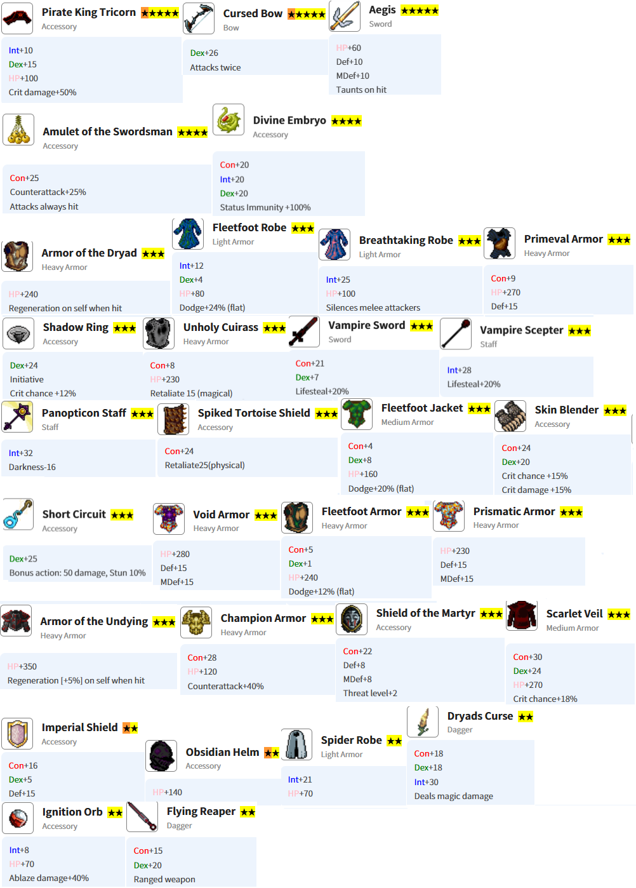

### 简介
这是一个纯单机、节奏很慢的放置游戏，只找到了手机端。

#### 优点
- 可供游玩很久
- 界面无广告，每天看5个广告给点钻石。当然可以选择充值免广告。
- 节奏非常慢。我一个副本刷一个星期都没能通关（自我嘲笑）。

#### 缺点
- 只有手机端
- 资料较少，甚至英文资料也不多。当然这也是我总结这篇攻略的重要原因。

### 进度
主队D11，D10还没能解锁R9，D1~D7均能单刷。
团本过了R9，R10 ~ R12 目前打的很挣扎，全看运气，最多也就三两波的程度。

### 基础教程

#### 资料站
韩国人有一个资料站，提供了诸如职业路线、地图掉落、合成配方等，链接：[韩文资料站](https://idleguildmaster.info/)。
点击右上角可以切换英语，或者使用网页翻译工具。

#### 兑换码

- 钻石：总计约3850
    - g75nfkf4 = 2000
    - fj9rf8hh = 1000
    - vrt4983y = 500
    - vrd75ywc = 250
    - e44ttr7z = 1000
- 物品：**仅限一次仅限一次仅限一次！！！以下代码仅为示例，认真想好需要什么再兑换** 
{}
仅限一次仅限一次仅限一次！！！以下代码仅为示例，认真想好需要什么再兑换 
{}
    - f3hqt045 + 物品名称：任意物品 * 1，比如：f3hqt045Sha
    - g394te919 + 物品名称：任意物品 * 9，比如：g394te919AmuletofResurrection
    > 其他可以考虑的物品：
    > - ~~NilPendant: +100% 经验~~随后又挖掘出了新兑换码有 +50% 经验的钻石护符，这个优先级暴跌。
    > - NilArmor: 终极坦克甲，我玩4个月才凑够一套做第一级装甲的材料，后面还能升级2次，猴年马月了
    > - ScarletShroud: 前一级光材料就要2600钻
    > - S.P.I.D.E.R: 额外攻击一次
    > - Evo23Vial: 改变次级特质，防止像我一样脸黑。**已知该药剂与天界母舰团本冲突，会导致不能打团本boss**
    > - Intercession: 晋升直接满级，省了几个月时间。**无使用案例反馈**
- 特殊：帮助新手开局，游戏秒变简单模式
    - f1r29u15eq
        - 1个45满级未晋升的皇家卫士，特质蛮力+专注。
        - 1件猩红面纱: 最好的皮甲，光材料就价值2600钻石，还需要至少4周等刷新。
        - 其他一般装备: 1件冠军甲（凑 100% 反击），1件D10皮夹，1个d8盾牌，2个吸血饰品。
    - rotdrv9deq
        - 100 白金
        - 所有药剂 * 100
        - 仪式蛋糕 * 10
        - 钻石护符 * 19: 50%经验
        - 35% 经验衣服若干（5 件幽灵兔斗篷 * 5，贵族盔甲 * 2，棉质夹克 * 10）

#### 职业梯度

个人排名，仅供参考
- T1: Celestial Rain, Night Lament
> 弓箭、夜贼
> 大力出奇迹
- T2: Eidolon, Eternal Fortress, Eldritch Alchemist, Archangel
> 吟游、泰坦、炼金、天使
> 团队必不可少
- T3: Inferno, Divine Duelist, Angel of War, Balrog
> 火法、皇家、圣骑、恶魔
> 有一定特长
- T4: Wyrm Rider, Whisper, Spirit Engraver, Black Regent, Black Idol
> 骑射、低语、出血、黑骑、巫妖
> 无关紧要

#### 如何赚钱和花钱
获得的材料不要直接买，加工会带来150%售价提升。
所以，赚钱的方法就是，分刷材料，制作，卖店，循环往复。

初期，集中资源购买队伍栏位。中期少量投入背包、工坊、商店。
宝石/商店：嘲讽剑是坦克毕业装。猩红装备太贵，量力而行。不要购买任何药水，可以掉落。
氪金：一旦你进入D6，背包空间就会非常紧张。有条件就购买新手包，否则只能升级背包，而放慢队伍进度。

### 进阶指引

#### 特质指引
未特殊指明时，无情对除力量职业外有益，诅咒都是负面的。恐吓对非力量职业有害。
- 法师
    - 天使｜++学生｜++同情, +天赋 
    - 恶魔｜++学生｜++敏捷, ++天赋, +专注
    - 巫妖｜+学生 ｜++警觉, +专注, +诅咒
    - 火法｜++学生｜+警觉, +专注。对内购的'学生+'火法就用'天赋'最优。
- 战士
    - 圣骑｜+蛮力 ｜++恐吓, +敏捷, +祝福, +专注
    - 黑骑｜+蛮力 ｜+专注, +警觉
    - 皇家｜++蛮力｜++恐吓, +专注, #诅咒, -敏捷
    - 泰坦｜+蛮力 ｜++敏捷, ++恐吓, +专注, +龙血, +巨魔血
- 贼
    - 吟游｜+野性 ｜++警觉, +同情, #无情
    - 夜贼｜++野性｜++无情, +夜行, -祝福
    - 出血｜++野性｜++专注, ++无情 
    - 低语｜+野性 ｜++专注, +无情, +天赋
- 射手
    - 炼金｜++野性｜++无情, +警觉, +恐吓
    - 弓箭｜++野性｜++无情, +天赋, +夜行
    - 毒弓｜++野性｜++无情, +天赋, +警觉
    - 骑射｜++野性｜++专注, +天赋

#### 宠物评价

- "好奇"~~是目前最强的特质，几乎所有宠物都应该把它放在第一或第二栏位~~ 更适合突袭团队宠物的第一特性。其他地图靠时间堆不缺掉落。
- "老师"的价值远超想象。升级是个非常漫长的过程，尤其是晋升后经验需求翻倍。尽量多准备吧，比如我现在可以单刷 D1 ~ D6，那就想要6个"老师"+恢复/吸血的宠物。
- "嗜血"和"抚慰"在单人刷 D1 ~ D3 时效果相近（两者都很棒），~~但它们作为第二特性会更好，第一特性应该是好奇~~ 单刷都需要一定的恢复手段，所以作为第二属性。另外，还可以准备一个高恢复的宠物。
- "治疗"在单人模式下稍逊一筹。它真正的优势在于作为主力团队宠物的第二特性
- "斗士"、"机会主义"和"野蛮"都是“快速杀敌”的选项。斗士更适合游戏前期，而另外两个则在后期才能真正发挥作用
- "明亮"和"诱饵"这两个特性都只在特定的单人刷图策略中才有用途。"诱饵"尤其适合单人 D6，第一特性为“明亮”的宠物可以准备一个给黑暗较高的情形。
- "机会主义"和"明亮"是少数适合第三个技能槽位的特性。
- "魔法"是一种糟糕的特质，某些魔法状态甚至会造成严重的损害
- "保护"虽然不至于有害，但它的效果不足以弥补占用技能栏位的不足
- "反击"几乎无用

{}
更新:
玩了几个月，个人觉得宠物配置应该是这样的
- 团队: 好奇 + 治疗 + 机会主义。赌双倍掉落。同时，"治疗"是可以每个队友回合都给当前最低血量回复，在多人队伍中比抚慰更智能。
- 刷图: 1 * "吸血 + 回复 + 机会主义"给皇家单刷，2 * "吸血 + 野蛮 + 机会主义"给敏捷职业，1 * "诱饵"给恶魔单刷，若干带恢复的宠物。
- 备用: 1 * "明亮" ，1 * 高恢复（双治疗 + 吸血）。
- 先用双特质宠物过渡，慢慢替换成3特质，甚至是4特质

{}

#### 队伍规划

初始招募以下几个角色
主坦：步兵 - 战士 - 守卫 - 铁卫
治疗：学徒 - 光明门徒 - 牧师 - 白魔法师 - 白大法师
远程：弓手 - 女猎手 - 神射手 - 必中手 - 愤怒
近战：盗贼 - 窃贼 - 暗影爬行者 - 暗影舞者 - 夜之刃 - 夜魅影
法系：学徒 - 熟练者 - 火系法师 - 红魔法师 - 红大法师

后续补充：
第三个输出，推荐火法，等不来弓手也行。
第二个治疗。可以多一个白法师，也可以考虑吟游（贼 - Trickster - Silver Tongue - Minstrel - Bard）
第四个输出，弓手（炼金：弓手 - 女猎手 - 神射手 - 毒弓 - Toxic Stalker - 炼金），或者法师（可以考虑死灵法师，纯单刷：学徒 - 熟练者 - 黑暗术士 - 死灵法师 - 解放者）。

这个时候已经有一队攻坚推进度，两或三组刷材料赚钱。再往后就是考虑补充还没有的职业，优先补一个皇家卫士（强力单刷战士，步兵 - 战士 - 守卫 - 皇家）。然后看心情选其他。

{}
更新:
到了游戏后期，就是敏捷职业（弓箭 + 夜贼）的天下。我甚至都想把法师全解雇了。
所以，遇到好的敏捷千万别错过。
当然，如果你像我一样，玩了4个月没见过一个野性+无情的弓箭或贼，没见过一个蛮力+敏捷的战士，就只能指望 Evo23Vial 了

{}

{}
再次加更:
如果现在让我规划队伍及组建顺序，以团本8人（后期12人）为例：
1 * 泰坦
2 * 天使
2 * 夜贼
3 * 弓箭
----------------- 8
1 * 恶魔（纯单刷）
1 * 皇家（纯单刷）
1 * 圣骑
1 * 火法
---------------- 12
1 * 吟游
1 * 炼金
1 * 骑射
---------------- 15

再多就随便了，可以全堆弓箭/夜贼。
韩国人好像有 12 * 弓箭，或者 12 * 炼金过最终团本的。

{}

#### 装备选择
总体原则：为了推进度，推荐尽快制作更换当前最高副本材料制作的装备。尤其要重视头盔，是推进度的好帮手。
另外可以参考这个装备推荐

### 刷图攻略

#### 刷图

每张图会有进度要求，比如杀100个怪，退出或团灭会重制计数。有些地图会有一些隐藏/稀有怪物或掉落
D1: 稀有怪金兔，打死后刷隐藏元素。前中期不用纠结这个，很难。
> 单刷：敏捷 < 42，或者省心就用非敏捷职业。
D2: 队伍必需有弓手，因为贼打不到飞鸟怪，还有这里怪物有魔防。不用纠结100个怪的计数，完成后只是连续几波沙人。
> 单刷：远程，配上一些恢复。
D3: 最好双火法，因为隐藏怪鬼火完全不吃物理伤害。鬼火的稀有掉落会吸引你回来刷一万遍的。
> 单刷：夜贼，魔法匕首，胚胎（后期伤害高了可以替换成输出或躲闪配件）。
D4: 混搭物理魔法输出。要给脆皮配头盔。这里的稀有掉落腐化匕首，是你固定一队在这里的原因。
> 单刷：恶魔，或者配高吸血的弓箭。
D5: 非常好的副本，任何输出都行，掉落大量食物，珍珠可以直接卖钱。留在这里直到你的队伍上限足够多。
> 单刷：皇家卫士，T5应该就可以尝试了，配装尽量反击100%，吸血剑，保证不死后换高伤武器。
D6: 双火法或者火法 + 魔法匕首的夜贼。等级高了伤害起来了自然就能过了。飞龙蛋只适合做坦克甲，而这个坦克甲用R1稀有材料还和其他后期装备冲突。所以不用刷飞龙。~~拦路虎。伤害很高，物理防御极高，初期通过不断灭团来获得一些材料，制作一些回血装备。然后靠运气刷够计数激活下一个副本。~~
> 单刷：恶魔，T7以上（T6也能打就是慢，大招不够清屏），吸血杖 + 躲闪衣服 + 胚胎，用猫头鹰。
D7: 感觉难度甚至比D6低。这里有一种魔免怪，要用纯物理队刷。这里装备很好，尽快刷材料提升战力。
> 单刷：夜贼，远程武器 + 躲闪衣服 + 躲闪鞋/手套，猫头鹰。后期伤害高了可以用猩红，配高吸血饰品或宠物。宠物吸血/爆击，或者猫头鹰。
D8: 坦补 + 夜贼 + 火法，夜贼堆敏捷，至少 90+，最好 100+，拆掉陷阱后就靠火法点燃拼伤害和脸了。~~树精+精灵+2*毒蛇，就是灭队组合。精灵25回蓝晕2回合，其他都是高攻击怪。这里的机制怪出来前有1000点陷进伤害，高等级的暗影贼都很难拆除，起码我的夜贼总死。头疼ing...~~
D9～D11: 从这里开始，都是 坦补 + 2个弓箭硬刷。甚至可以4个弓箭刷。
D11: 物理伤害畸高，给坦克穿上最好的物防装备，或者就改用闪避流。
> 单刷：恶魔，吸血杖 + 躲闪套，用猫头鹰。最好T8，T9注意观察是否会伤害溢出打死萨满。目的是获取boss掉落，来制作贼的远程武器，或升级诅咒弓。其他小怪单刷不了。

#### 团本

团本，游戏内翻译成突袭，分为两类。团本每天可尝试一次，30钻购买额外次数。
- 普通团本：通关不会消失，每次从头开始。
- 史诗团本：进度保存，通关消失，boss掉落是唯一的。可以采取敢死队战术，每天过一波，很快就能通关。

R1: 
R2E: 要求全队体质200以上才能见到boss. boss不攻击，7回合打死就行，否则全屏秒杀。
R3: 多带点AOE，小怪数量较多。boss带两根柱子，攻击打到柱子上就是1点伤害，所以洗脸吧。
R4E: 可以用恶魔清场战术。其他人负责拖时间，等恶魔开大清场，然后明天继续。
R5: boss分两种，不带骷髅钥匙见双法师，带上就是泰坦。建议先刷泰坦出3个粉末做盾牌。
R6E: 前面的幽灵步兵伤害极高，建议恶魔清场战术
R7: 100黑暗。两种打法：带满明亮装备宠物，或者夜贼+猫头鹰赌运气。卡了我很久，法师按黑暗几率全屏晕，猎犬锁最低血，一旦减员就会血崩。
R8: 
R9: 
R10: 
R11: 
R12: 

